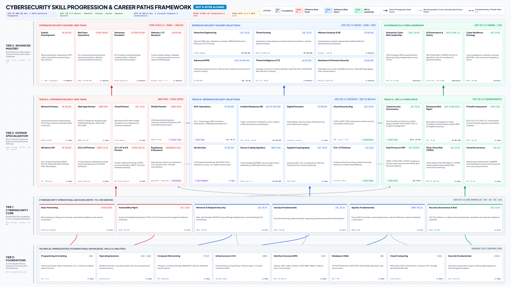
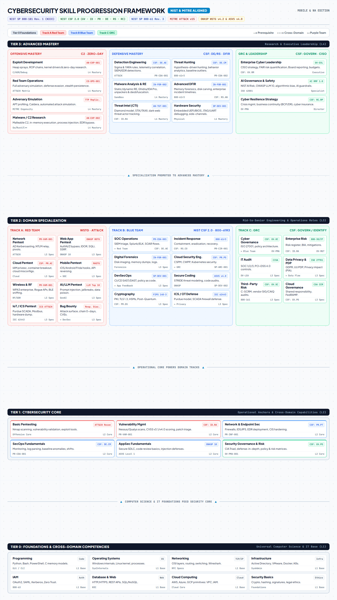

# Cybersecurity Skill Progression & Career Paths Framework

[-blue.svg)](https://csrc.nist.gov/publications/detail/sp/800-181/rev-1/final)
[-green.svg)](https://www.nist.gov/cyberframework)
[](https://csrc.nist.gov/publications/detail/sp/800-61/rev-3/final)
[](https://attack.mitre.org/)
[](https://owasp.org/)

An exhaustive, high-resolution infographic and architectural framework mapping cybersecurity competencies, specialized engineering disciplines, and executive career pathways. Fully synchronized with **NIST SP 800-181 Rev. 1 (NICE Workforce Framework)**, **NIST Cybersecurity Framework (CSF) 2.0**, **NIST SP 800-61 Rev. 3**, **MITRE ATT&CK v15**, and **OWASP WSTG v4.2 / ASVS v4.0**.

---

## 🖼️ Visual Previews

### 1. Master Landscape Edition (4K / 8K UHD)


### 2. Mobile Portrait Edition (WhatsApp Photo & Smartphone Ready)
<div align="center">
  
</div>

---

## 📥 Direct Downloads & Editions

| Edition | Format | Resolution | File Size | Recommended Use Case |
| :--- | :---: | :---: | :---: | :--- |
| **8K Super UHD Master** | `.png` | 7680 × 4320 | ~1.60 MB | Large-format print, conference wall banners, ultra-deep zooming |
| **4K UHD Master** | `.png` | 3840 × 2160 | ~0.76 MB | 4K monitors, slide decks, keynote presentations, desktop wallpaper |
| **Mobile Portrait (WA Photo)** | `.jpg` | 1440 × 2560 | ~1.38 MB | **WhatsApp sharing as regular Photo (Chat/Status)** — 100% full screen on phones without rotate |
| **Mobile Portrait (Lossless)** | `.png` | 1440 × 2560 | ~1.35 MB | WhatsApp Document, Telegram, Instagram Stories, high-res smartphone viewer |
| **WhatsApp QHD Landscape** | `.jpg` | 2560 × 1440 | ~1.17 MB | WhatsApp chat (tap **HD** button before sending) |
| **WhatsApp QHD Lossless** | `.png` | 2560 × 1440 | ~1.06 MB | WhatsApp Document / Slack / Teams lossless sharing |
| **Interactive Web Edition** | `.html` | Responsive SVG | ~28 KB | Open in Chrome, Edge, or Safari with infinite vector zoom |

---

## 📱 Panduan Kirim ke WhatsApp Agar Tidak Pecah (Tips Anti-Blur)

WhatsApp secara *default* mengompresi foto menggunakan algoritma lossy yang cukup agresif. Agar infografis tetap tajam dan terbaca jelas:

1. **Gunakan Edisi Portrait (`cybersecurity_framework_mobile_portrait.jpg`)**:
   - Mengapa? Layar smartphone adalah vertikal. Edisi portrait mengisi 100% layar HP tanpa terpotong (*letterboxing*) dan teks dibuat ekstra tebal sehingga langsung terbaca saat dikirim via menu Foto biasa.
2. **Aktifkan Tombol HD di WhatsApp**:
   - Saat memilih foto di WhatsApp, ketuk tombol **HD** di bilah atas layar (sebelah kiri tombol crop/stiker), lalu pilih **HD Quality**. WhatsApp akan mengirim gambar dalam resolusi penuh tanpa kompresi ekstrem.
3. **Kirim Sebagai Dokumen (*Send as Document*)**:
   - Jika ingin membagikan edisi 4K atau 8K, kirim melalui menu **Lampiran (Attachment) ➔ Dokumen (Document)** agar berkas dikirim bit-for-bit secara *lossless* tanpa kompresi sama sekali.

---

## 🏛️ Framework Architecture & Tier Hierarchy

```
+----------------------------------------------------------------------------------------------------+
|                                    TIER 3: ADVANCED MASTERY                                        |
|  Track A: Offensive Mastery     |  Track B: Defensive Mastery         |  Track C: GRC & Leadership |
|  - Exploit Development          |  - Detection Engineering (DE.AE)    |  - Enterprise Risk (OV-EXL)|
|  - Red Team Operations          |  - Threat Hunting (DE.CM)           |  - AI Governance (RMF 1.0) |
|  - Adversary Emulation          |  - Malware Analysis & RE (IN-FOR)   |  - Cyber Resilience (RC.RP)|
|  - Malware / C2 Research        |  - Advanced DFIR (800-61r3)         |                            |
|                                 |  - Threat Intelligence (AN-TGT)     |                            |
|                                 |  - Hardware & Firmware Security     |                            |
+----------------------------------------------------------------------------------------------------+
                                                  ▲
+----------------------------------------------------------------------------------------------------+
|                                 TIER 2: DOMAIN SPECIALIZATION                                      |
|  Track A: Offensive (Red Team)  |  Track B: Defensive (Blue Team)     |  Track C: GRC & Compliance |
|  - Network Pentest (PR-VAM-001) |  - SOC Operations (PR-CDA-001)      |  - Governance (GV.OC)      |
|  - Web App Pentest (WSTG v4.2)  |  - Incident Response (PR-CIR-001)   |  - Enterprise Risk (ID.RA) |
|  - Cloud Pentest (PR.AC)        |  - Digital Forensics (IN-FOR-001)   |  - IT Audit (CISA)         |
|  - Mobile Pentest (MASTG) ◄────┼──► Cloud Security Eng. (PR.PS) ◄────┼──► Privacy & PDP (27701)   |
|  - Wireless & RF (802.11/BLE)   |  - DevSecOps (SP-DEV-001)           |  - Third-Party Risk (GV.SC)|
|  - AI & LLM Pentest (LLM 10)    |  - Secure Coding (ASVS v4.0)        |  - Cloud Governance (CCM)  |
|  - IoT/OT & ICS Pentest         |  - Applied Cryptography (FIPS 140-3)|                            |
|  - Bug Bounty & Research ◄─────┼──► ICS / OT Defense (IEC 62443) ◄───┼────────────────────────────+
+----------------------------------------------------------------------------------------------------+
                                                  ▲
+----------------------------------------------------------------------------------------------------+
|                                  TIER 1: CYBERSECURITY CORE                                        |
|  Basic Pentesting  | Vuln Mgmt | Network & Endpoint | SecOps Fund. | AppSec Fund. | Security Gov.  |
|  (ATT&CK Recon)    | (ID.RA)   | (PR.PT)            | (DE.CM)      | (OWASP 10)   | (GV.PO)        |
+----------------------------------------------------------------------------------------------------+
                                                  ▲
+----------------------------------------------------------------------------------------------------+
|                          TIER 0: FOUNDATIONS & CROSS-DOMAIN COMPETENCIES                           |
|  Programming & Scripting | Operating Systems | Networking (TCP/IP) | Infrastructure & Virt.        |
|  Identity & Access (IAM) | Database & Web    | Cloud Computing     | Security Fundamentals         |
+----------------------------------------------------------------------------------------------------+
```

---

## 📋 Standards & Taxonomy Alignment Matrix

| Standard / Framework | Release Version | Applied Scope & Controls Mapped |
| :--- | :---: | :--- |
| **NICE Workforce Framework** | NIST SP 800-181 Rev. 1 | Career work roles mapped across tiers: `AN-EXP`, `CO-OPS`, `PR-CDA`, `PR-CIR`, `IN-FOR`, `SP-DEV`, `SP-ARC`, `OV-EXL`, `OV-MGT`, `OV-LEA`, `OV-PMA`. |
| **NIST Cybersecurity Framework** | CSF 2.0 (2024) | Six core functions integrated: **Govern (GV)**, **Identify (ID)**, **Protect (PR)**, **Detect (DE)**, **Respond (RS)**, and **Recover (RC)**. |
| **Incident Response Recommendations** | NIST SP 800-61 Rev. 3 | Multi-party incident handling, containment, forensics timeline preservation, and eradication coordination. |
| **MITRE ATT&CK Matrix** | Enterprise & ICS v15 | Tactics & techniques across Reconnaissance, Initial Access, Execution, Persistence, Privilege Escalation, Defense Evasion, Lateral Movement, and C2. |
| **OWASP Standards** | WSTG v4.2 / ASVS v4.0 / MASTG | Web App Security Testing (12 domain categories), Application Security Verification (Levels 1-3), Mobile app reversing, and LLM Top 10 vulnerabilities. |

---

## 🚀 Interactive Vector Web Edition
To launch the interactive SVG roadmap in your local browser:
```bash
# Clone the repository
git clone https://github.com/dany-side/dump_repo.git

# Open the interactive HTML in your browser
cd dump_repo
start index.html       # Windows
open index.html        # macOS
xdg-open index.html    # Linux
```

---
*Maintained and synchronized automatically.*
